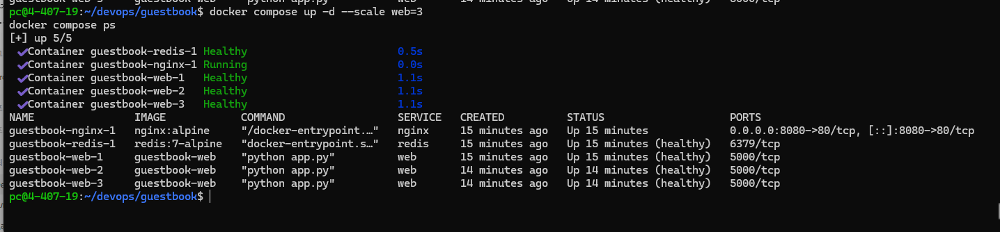
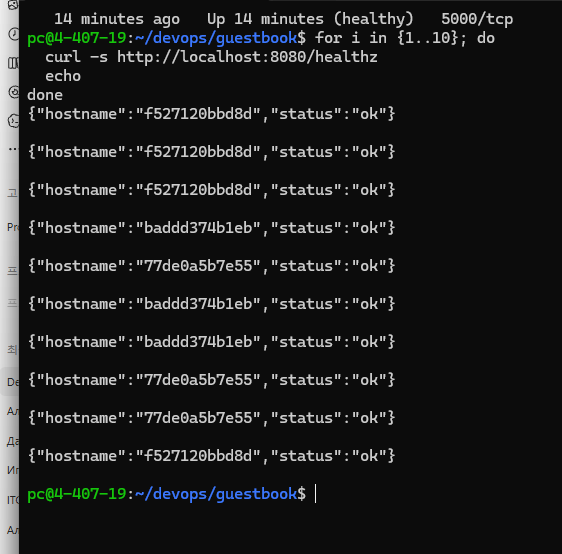
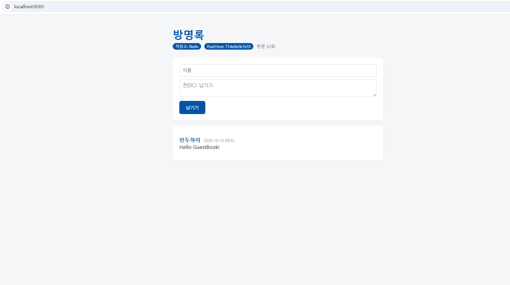
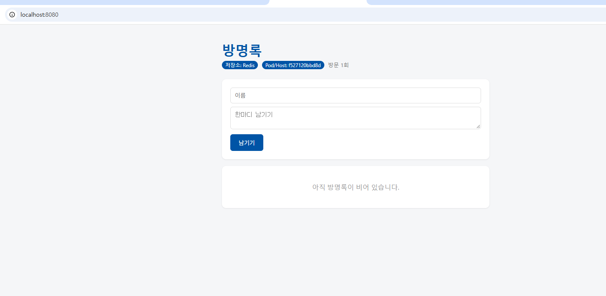

# Week 07 - Docker Compose

## 1. 실습 목표
- Docker Compose를 사용하여 여러 컨테이너 실행
- Nginx Reverse Proxy 설정
- Web 애플리케이션과 Redis 연결
- Healthcheck 및 데이터 영속성 확인
- Web 컨테이너 3개로 확장하고 요청 분산 확인

## 2. 실행 환경
- Nginx
- Flask Web
- Redis
- Docker Compose

## 3. 컨테이너 상태 확인
`docker compose ps` 명령어로 nginx, redis, web 컨테이너가 실행 중인지 확인했다. Web 컨테이너 3개와 Redis의 상태가 healthy인 것을 확인했다.

## 4. 로드 밸런싱 확인
`docker compose up -d --scale web=3` 명령어로 Web 컨테이너를 3개로 확장했다.

`curl -s http://localhost:8080/healthz` 명령어를 반복 실행한 결과, 서로 다른 3개의 hostname이 확인되었다. 이를 통해 Nginx가 여러 Web 컨테이너로 요청을 분산하는 것을 확인했다.

## 5. 데이터 영속성 확인
`docker compose down` 후 다시 실행했을 때 기존 방명록 데이터가 유지되는 것을 확인했다.

`docker compose down -v` 명령어로 볼륨을 삭제한 후 다시 실행했을 때 기존 방명록 데이터가 삭제되는 것을 확인했다.

## 6. 환경변수 보안
`.env` 파일에는 Redis 비밀번호와 같은 민감한 정보가 포함될 수 있으므로 Git에 커밋하지 않아야 한다. `.gitignore`에 `guestbook/.env`를 추가했다.

## 7. 결론
Docker Compose를 사용하여 여러 컨테이너를 실행하고, Healthcheck, 데이터 영속성 및 Nginx 요청 분산을 확인했다.

## Screenshots

### Docker Compose Status and Scaling

### Load Balancing

### Data Persistence

### Data Deleted with down -v

